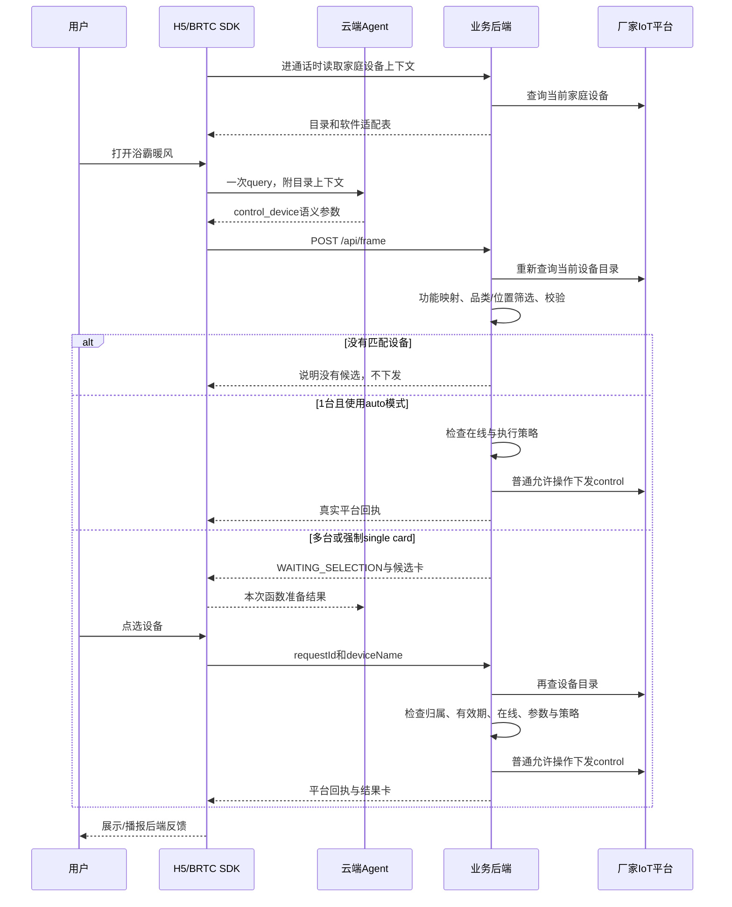

# 云端意图、动态家庭与 C 端应用解耦分析

## 1 结论

当前实现已把设备控制的模型语义识别、业务候选处理和 IoT 协议请求分成不同模块，可以用于当前家庭的功能试点。它仍是单家庭配置的测试系统，尚未做到支持多用户、多家庭和任意新设备功能的完整解耦。

后端承担的是业务执行编排，包括设备查询、能力与位置筛选、参数合法性、在线检查、选择和确认、下发、防重复及结果审计。把后端缩减为“只数设备”会丢掉现有执行规则。

本文区分源码中已经实现的行为与后续建议；不把建议架构当作已经完成的能力。本次没有执行新一轮真机控制验收。

## 2 首页推荐语调整

按当前家庭933的三台设备，首页采用以下顺序：

| 顺序 | 推荐原话 | 方向 |
| ---: | --- | --- |
| 1 | 打开马桶冲水 | 当前软件适配的大冲控制 |
| 2 | 打开浴霸暖风 | 浴霸暖风控制 |
| 3 | 打开镜柜夜灯 | 镜柜夜灯控制 |
| 4 | 关闭浴霸暖风 | 常用关闭操作 |
| 5 | 马桶自动润瓷有什么用 | 产品知识问答 |
| 6 | 怎么打开浴霸暖风 | 使用方法问答，不立即执行 |
| 7 | 我家马桶不出水了，要报修 | 故障报修入口 |
| 8 | 查看我的报修进度 | 报修记录入口 |

这些提示词不绑定主卫、客卫或不在当前家庭里的浴缸。它们是用户原话，点击后仍走正常业务流程。

实现上，推荐语由 `config/scenario.json` 提供，经 `/api/config` 返回，前端按配置渲染。已移除 HTML 中重复写死的推荐按钮；后续改推荐语不用同时修改两套文本。当前服务仍在启动时读取该配置，配置变更需重载服务。

本地8912服务已重载，沿用原状态目录并保留测试历史。页面已显示上述八条推荐语，重连后云端通话状态为“已连接”，输入框可用；真实IoT目录刷新成功，返回当前三台设备。此前出现过Janus信令连接失败，后续重连恢复，本次没有下发真机控制。截图保存在`output/playwright/homepage-prompts-2026-11-22.jpg`。

当前加入的是故障报修与进度跳转。真正的报警事件列表、漏水报警通知、报警确认或解除，以及厂商 App 的报警详情页，尚需厂家提供对应能力和页面协议。报修卡片只提供入口，不等于创建工单或查询到工单进度。

## 3 当前意图到底在哪里识别

| 请求类型 | 当前前端行为 | 主要处理位置 |
| --- | --- | --- |
| 普通设备控制 | `DEVICE_ROUTE=cloud` 时不进入本地 `/api/intent` | 云端 Agent 识别并发出控制 Function Call，业务后端执行 |
| 普通知识问答 | 发送到 BRTC Agent | 云端知识与回答逻辑 |
| 报修／报修进度 | `repairKind` 规则先命中，直接生成入口卡 | 前端分流与厂商 App 跳转 |
| 数据统计／检修分析 | `TOPIC` 规则先命中，转 `/api/topic` | 另一个业务适配层，未统一由该 BRTC Agent 路由 |
| 模型误把知识问答当控制 | Function Call 到达后再次检查明确知识／状态表达 | 后端执行兜底，可拒绝下发 |

因此，“设备控制的第一轮主要语义识别在云端”符合当前配置；“全部意图都在云端识别”不符合当前源码。

前端规则、云端意图配置、后端 `FN_ACTION` 映射目前同时存在。要让新增业务意图具有统一接入方式，后续应收敛成一个工具分发入口，前端以展示和用户选择为主。

来源：`public/app.js` 的 `sendText`、`repairKind`；`server.mjs` 的 `/api/intent`、`/api/frame`、`/api/topic`；`src/device-catalog.mjs` 的 `resolveControl`。

## 4 当前设备控制链路

### 4.1 实际消息流



图中的直接下发适用于策略放行的普通操作；高风险操作还会进入页面确认，确认后才下发。

当前8912服务特意配置了 `DEVICE_SINGLE=card`，因此只有一台也出卡。源码默认 `auto` 分支支持唯一候选的自动执行，两种行为由业务策略决定。

当前还不是严格的“识别完才第一次查询目录”：进通话时会先读一次目录，并把它附在用户 query 中；Function Call 到达后，后端会强制重新查目录；点卡时还会再查。这三次查询分别服务于模型上下文、准备候选和提交前复核。

### 4.2 Function Call 的意义

模型把“打开浴霸暖风”转成结构化的执行请求，例如：

```json
{
  "function_name": "control_device",
  "parameters": {
    "categoryCode": "02",
    "feature": "warm_air",
    "operation": "on"
  }
}
```

这是语义层与业务执行层的契约。模型提出品类、功能和操作；后端查找真实实例、决定是否允许执行，并把语义映射成厂家 `cmd/param/value`。

Function Call 本身不携带充分的用户授权证明，也不等于设备已经执行。当前函数名是 `control_device`，但多设备时它的第一次执行结果实际上是“控制准备完成，等待选设备”。

源码的初次函数返回可能是 `result=ok`，同时业务状态为 `WAITING_SELECTION`；此处 ok 表示准备步骤可继续。后续应让状态表达更明确，持续区分“等待选择”“等待确认”“平台受理”“设备动作确认”“失败”，避免模型把准备成功理解成执行完成。

### 4.3 查设备是否是二次确认

查询和筛选属于实例解析：把模型识别的“浴霸＋暖风＋打开”落实到当前家庭的真实设备号。

- 0台：没有可执行实例，说明原因。
- 1台：目标唯一，按单台策略执行或出卡。
- 多台：请用户消除目标歧义，选择哪一台。
- 高风险：即使目标唯一，仍可能需要额外确认操作。

多台选设备与高风险确认属于不同业务步骤。两者都由后端控制，不能由模型猜一台设备替代用户选择。

### 4.4 是否变成异步操作，是否需要第二次query

需要等待用户点卡时，业务流程分成“准备”和“提交”两个阶段，这是一种异步交互。

当前代码已经把待执行动作保存在后端的 `pending` 中。用户点卡只提交 `requestId` 和 `deviceName`，后端取回原操作并执行，所以不需要让模型再次识别同一句原话，也不需要第二次用户 query 才能完成下发。

当前最终选择回执通过 H5 展示并发送 `[TTS]` 播报；点卡完成后没有统一再提交原 Function Call 的终态结果。这能跑通界面反馈，但会限制模型对“上一轮究竟选了哪台、操作结果怎样”的后续理解。要增强多轮体验，需要把目标与终态也更新到会话上下文或业务事件中。

IoT 请求由业务后端实际发出。现在它在本地电脑运行；部署为 C 端应用时，这一层应成为服务器上的业务服务。用户设备承担界面、SDK交互与选择确认。

## 5 解耦现状与动态Home ID

| 维度 | 当前实现 | 还需处理 |
| --- | --- | --- |
| 模型与实际下发 | 已通过Function Call和后端执行模块分开 | 固定语义契约、返回状态及工具版本 |
| 设备实例 | 控制准备与选卡时从IoT重新查询，不依赖固定设备数量 | 保持目录和会话上下文更新 |
| 房间与昵称 | 优先读真实目录，缺少时可空 | 厂家提供room，或业务端维护用户设置，禁止写死主卫/客卫 |
| 设备能力 | 接口未给能力时，按四种已适配品类补软件能力 | 按设备/产品/固件提供真实功能元数据 |
| 功能与协议 | `scenario.commands`、类别/功能别名和参数校验仍是本地适配 | 封装成版本化IoT适配器或数据驱动能力注册表 |
| 家庭 | 进程启动时设置一个全局Home ID | 改成经过授权的请求/会话上下文 |
| 用户与凭证 | 全局IoT客户端和凭证；未接入C端登录和家庭成员模型 | 用户、家庭与凭证绑定、续期和权限校验 |
| 工作流状态 | 选择、函数去重、确认使用进程内Map | 持久化和多实例一致性，支持重启/断线恢复 |
| 意图入口 | 控制云端；报修/统计前端分流；后端识别固定函数名 | 统一工具分发、参数校验和处理器注册 |

### 5.1 只动态传入Home ID为什么不够

当前 `scenario.mjs` 在模块加载时把 `IOT_HOME_ID` 写入全局 `SCENARIO.iot.homeId`。`server.mjs` 的目录缓存、`createTurn` 的执行、`createDeviceController` 的选择记录都依赖它；`createGate` 还在初始化时捕获了该Home ID。

因此，给某个HTTP请求增加一个homeId字段，不能使这些模块自动按用户分离。客户端请求另一个homeId，当前实现通常会因与全局家庭不一致而拒绝。若直接改全局对象，又可能使校验、缓存和待执行动作处于不同家庭状态。

建议每个请求/会话建立可信上下文：

```json
{
  "userId": "来自已认证登录",
  "homeId": "已校验为该用户可访问的家庭",
  "sessionId": "当前对话",
  "requestId": "当前控制工作流",
  "credentialRef": "服务端保存的凭证引用"
}
```

Home ID应由登录用户的家庭选择确定，并在服务器验证。模型填的Home ID、设备名或品类都不能代替授权检查。

目录缓存、待选择记录、确认记录和审计需要绑定用户与家庭；切换家庭时使旧选择卡失效，更新模型设备上下文。IoT客户端应按凭证引用选择正确授权范围，避免全局token承担所有用户的操作。

### 5.2 哪些新增能力可以少改代码

| 后续变化 | 典型改动 |
| --- | --- |
| 增加同品类、同协议、相同已适配功能的设备 | 目录自然增加；通常不用新增匹配代码，但须验证候选/在线/权限 |
| 已有功能新增表达方式 | 主要调整云端意图例句、人设或知识；做召回和错误触发回归 |
| 改知识资料 | 更新知识库；不需要增加控制处理器 |
| 给已有功能增加一种产品适配 | 更新设备能力与指令适配数据，必要时同步模型目录上下文 |
| 新功能仍使用既有通用参数契约 | 需要新增能力/指令定义、合法值和策略；通用执行器可复用 |
| 新数值参数、范围、单位或新厂家协议 | 需要适配器及参数校验处理；当前switch开关契约不能覆盖任意新参数 |
| 新Function Call业务，如报警确认、工单创建 | 云端新增工具定义，后端新增/注册处理器及真实接口，前端支持结果展示 |
| 多用户动态家庭 | 改上下文、权限、凭证、缓存和状态存储；不止修改云端参数 |

当前后端 `FN_ACTION` 只认识已登记的函数；未知函数会返回“未接入的意图”。因此，只改Function Call配置能改变模型输出，不能自动生成对应业务能力。

## 6 厂家与业务服务的职责

| 能力 | 厂家当前已提供/应补充 | 我们的业务端职责 |
| --- | --- | --- |
| 家庭设备目录 | 当前device-list提供deviceName、categoryCode、deviceTagName、onlineStatus | 按家庭查询，按意图品类/能力/用户明确位置筛选 |
| 实际设备控制 | 当前control接受homeId和cmdList | 构造正确字段、校验、调用、去重和审计 |
| 场景创建 | 当前scene接受条件和动作 | 解析合法条件、选择设备、验证参数与策略；创建不等于已触发 |
| 房间与能力 | 当前目录文档未列room、功能列表、参数范围 | 厂家提供元数据，或业务端按正式产品定义维护适配表 |
| 用户与家庭权限 | 厂家明确token归属、可访问家庭、授权与续期方式 | 登录态绑定、每次校验家庭/设备归属，不把token交给模型 |
| 设备功能状态/执行结果 | 当前文档返回在线状态与平台请求结果；未提供动作完成回调 | 若要确认动作，接状态查询/事件回调；明确区分平台受理与设备完成 |
| 报修与进度 | 厂家App页面及deeplink协议；正式工单API若需AI创建/查询 | 当前返回入口；接API后才能宣称创建或查到进度 |
| 报警 | 提供报警事件、设备关联、详情页及确认/解除能力 | 事件关联、卡片展示、权限与用户确认，不能用报修入口冒充报警处理 |

厂家平台承担设备连接、协议和实际硬件执行，我们承担对话业务如何落实到当前用户、家庭和操作。能力元数据越完整，软件端按名称、品类或型号做额外猜测的需求越少；业务授权和执行策略仍需要保留。

## 7 是否可以面向C端

作为当前家庭的受控试点，控制→选择→业务下发→平台回执的交互方向成立。作为多用户正式应用，需要优先补齐以下已有缺口：

1. **用户与家庭隔离**：HTTP路由当前未见登录用户/家庭成员权限校验；会话、设备目录和审计接口使用全局上下文。
2. **模型召回与反馈**：2026-11-21的真实云端＋模拟IoT完整首测87/111，仍有漏Function Call、静默和无下发却虚报执行。不能把21个适配组合通过理解成全部自然语言稳定通过。
3. **真实设备能力与动作反馈**：2026-11-22目录连接成功，三台在线；所生成的真机场景用例需要人工判定。平台受理与实际动作须分别记录。
4. **工作流持久化**：进程内选择/确认/去重状态需要可恢复存储；统一处理中断、过期、取消和重复提交。
5. **统一意图入口与终态**：报修/统计的前端分流、云端工具和后端处理器需要一致契约；点卡后的目标和执行终态需要进入会话上下文。
6. **App跳转闭环**：厂商App/WebView须支持对应deep link；桌面H5展示卡片不等于目标App页面已打开。

源码还有一处需在收敛报修链路时修正：`FN_ACTION`把`open_repair`转换为`repair.open`，但`actionFromCall`的专用分支比较的是`open_repair`，导致kind参数未按该分支解析；前端Function Call回调又跳过了`demo.repair`卡片。当前报修推荐依赖前端规则能展示入口，不能据此认为云端报修处理已统一完成。

## 8 建议的推进顺序

1. 先把当前三台真实设备的17个适配组合与历史失败话术验收清楚，修复漏调用和虚报反馈。
2. 先建立登录用户、授权家庭及凭证上下文，再实现动态Home ID；目录、卡片和审计都按上下文隔离。
3. 固定模型的语义契约，把品类、能力、参数和厂家cmd映射收进版本化适配器。新增设备优先加元数据，复杂新参数再扩展处理器。
4. 统一工具处理器注册与结果状态；把报修、统计和报警等新业务按真实接口接入。
5. 补执行终态、设备状态事件、持久化和断线恢复，再扩大C端试点范围。

目标是让模型配置、家庭数据、厂家协议和业务执行各自有稳定边界，能独立演进。当前需要继续保留并规范后端业务规则。

## 9 源码与证据

- 首页配置：[scenario.json](../../config/scenario.json#L18)
- 家庭启动配置：[scenario.mjs](../../scenario.mjs#L16)
- 后端目录与接口：[server.mjs](../../server.mjs#L73)
- 前端分流：[app.js](../../public/app.js#L803)
- 选择控制编排：[device-controller.mjs](../../src/device-controller.mjs#L41)
- 功能与候选解析：[device-catalog.mjs](../../src/device-catalog.mjs#L80)
- 家庭/参数/风险校验：[policy.mjs](../../src/policy.mjs#L11)
- 厂家协议请求与回执：[turn.mjs](../../src/turn.mjs#L6)
- 函数映射：[frames.mjs](../../src/frames.mjs#L56)
- 厂家原接口文档：[设备控制.md](/Users/chenpengjian/Documents/百度项目管理/baidu/20_客户项目/DumateApi接入/箭牌demo打通/iot接口文档/设备控制.md#L50)
- 已执行完整验收：[2026-11-21验收报告](../测试报告/2026-11-21-IoT全量控制下发验收.md#L90)
- 真机待测计划：[2026-11-22手工测试](../测试用例/2026-11-22-真实IoT场景手工测试.md#L11)
