## 摘要

按 2026-11-05 的源码整理。流程图描述运行中的分支，章节说明对应文件和函数。与 README 不一致时，以代码为准。

# 模块流程架构

这套 H5 是浏览器页面加一个 Node 进程。语音、识别和播报在百度 BRTC 房间里完成，不经过本服务。本服务负责建实例、授权帧、把一句话分成统计、报修、设备或产品问答，再决定能不能打到箭牌 IoT。

人设和知识库在百度控制台，见 `产品文档/后台控制台交付配置.md`。本文只写软件里实际走过的逻辑。

## 1. 总流程

浏览器有两条边。一条直连 BRTC，走音频和字幕。一条打本机 HTTP，走业务。

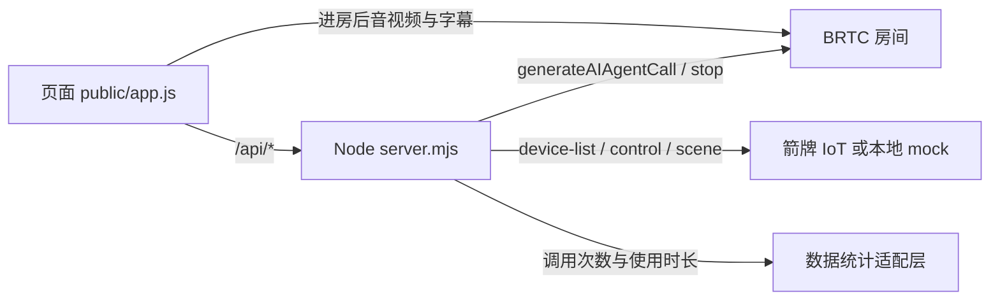

启动时 `server.mjs` 读 `.env` 和 `config/scenario.json`，设备名单读 `../箭牌demo打通/iot/devices.json`（`IOT_FIXTURE=real` 时改读 `devices.real.json`）。`IOT_MODE=mock` 先在 `127.0.0.1:18901` 起本地网关，再听 `PORT`（默认 8900）。`real` 直接打 `IOT_BASE_URL`。

页面加载后请求 `GET /api/config`。四件套 `BRTC_APPID`、`BRTC_AK`、`BRTC_SK`、`BRTC_LICKEY` 齐了才调用 `startCall()`。缺一项时输入框保持关闭。

## 2. 模块架构

模块按边界分成四块：浏览器、Node 编排进程、BRTC、箭牌 IoT。可交互的图在 `docs/模块架构.html`，源规格在 `docs/模块架构.archify.json`。图里可以按「设备下发」「进房授权」「帧、补槽与记录」三条视图聚焦。

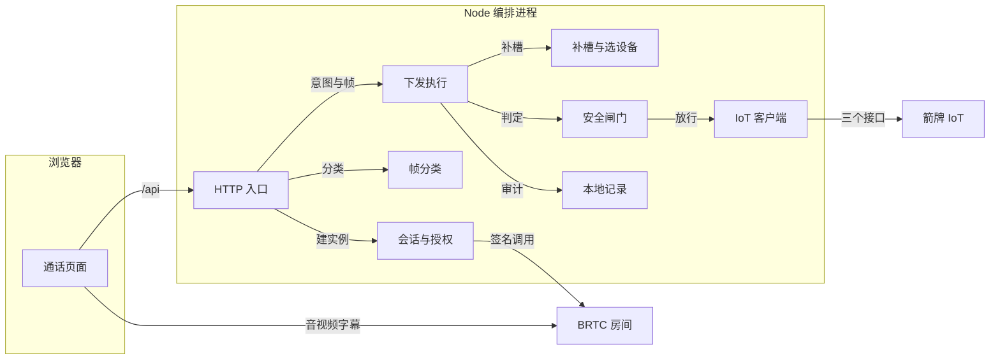

| 模块 | 文件 | 在架构里的位置 |
| --- | --- | --- |
| 通话页面 | `public/app.js`、`public/turn-gate.js` | 浏览器。分流、语音、字幕、回合代号 |
| HTTP 入口 | `server.mjs`、`src/topic.mjs` | 编排进程的总入口。统计话题在这里直接转出，不进闸门 |
| 会话与授权 | `src/session.mjs`、`src/aiagent.mjs` | 建实例、拼激活帧。AK、SK、license 只留在这里 |
| 帧分类 | `src/frames.mjs`、`src/roster.mjs` | 把 `[F]`、`[A]` 收成动作，并截掉不该给用户看的清单 |
| 下发执行 | `src/turn.mjs` | 报修短路、选设备、调用闸门、打 IoT、写回执 |
| 补槽与选设备 | `src/resolve.mjs` | 按原话补指令，多台时交出选择列表 |
| 安全闸门 | `src/policy.mjs` | 唯一决定能不能下发的地方 |
| IoT 客户端 | `src/iot-client.mjs` | 设备列表、控制、建场景 |
| 本地记录 | `src/audit.mjs`、`src/journal.mjs`、`state.json` | 审计、卡片流水、会话摘要 |
| BRTC 房间 | 百度云 | 听、说、识别、播报。页面直连，音频不经过 Node |
| 箭牌 IoT | UAT 网关 | 只有闸门放行后，客户端才出站 |

统计适配层没有单独画成一块。`topic.mjs` 挂在 HTTP 入口上，命中后直连适配层，不经过下发执行，也不经过闸门。

主路径是一条横线：通话页面到 HTTP 入口，到下发执行，到安全闸门，到 IoT 客户端，再到箭牌 IoT。会话、帧分类、补槽和本地记录都从这条线分出去，自己不打设备。

## 3. 进房与授权

实现：`public/app.js` 的 `startCall`、`startRtc`、`onAgentFrame`；`src/session.mjs`；`src/aiagent.mjs`。

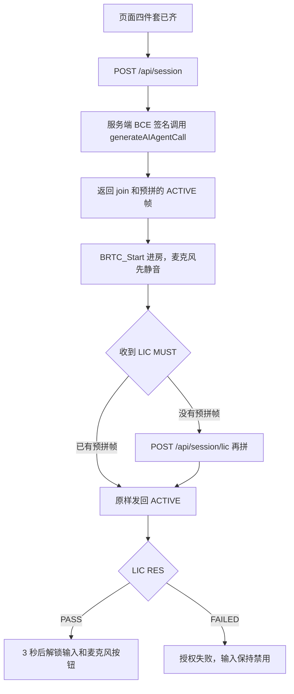

建实例不传 `sceneRoleCfg`。`agentConfig()` 只带这些运行参数：`lang=zh`、`asr_long_audio_mode=true`、`disable_voice_auto_int=true`、热词、`tts_sayhi`。人设用控制台已绑定的自定义角色。

`POST /api/session` 生成会话号 `hs_`，把进房 token、房间名、uid 交给页面。AK、SK、licenseKey 不出进程。预拼的激活帧是 `[E]:[LIC]:[ACTIVE]`，`devId` 用固定的 `BRTC_DEVID`。换设备号会按新设备计一次激活。

房间推 `[E]:[LIC]:[MUST]` 时，页面优先把开通话时拿到的那一帧发回去。没有这帧才走 `POST /api/session/lic`。结果帧走 `POST /api/session/lic-result`：`PASS` 把会话标成通过，3 秒后收起启动层并打开输入；`FAILED` 返回 403，输入不开。

`PASS` 之前，字幕里的业务帧可以到达页面，但麦克风按钮在 `licPassed` 之前按下去会被拒绝。

结束通话：页面 `BRTC_Stop`，再 `POST /api/session/stop`。服务端调用 `stopAIAgentInstance`，并从内存删掉这次会话。

## 4. 一句话进来之后

所有文字、快捷句、识别最终结果都进 `sendText()`。顺序是固定的，命中即停。

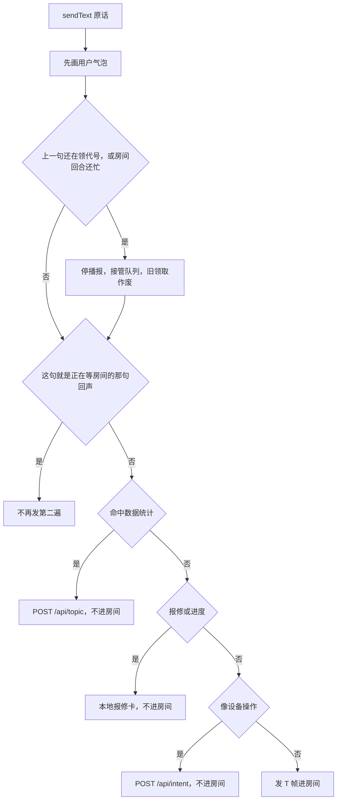

判定函数都在 `public/app.js`。

| 顺序 | 条件 | 去向 | 进房间 |
| --- | --- | --- | --- |
| 1 | `TOPIC`：调用次数、失败几次、检修报告、使用时长、用了多久 | `POST /api/topic` | 否 |
| 2 | `repairKind()` | 本地卡片 + `arrowhome://` | 否 |
| 3 | `wantsDevice()` | `POST /api/intent` | 否 |
| 4 | 其余，含产品问答和闲聊 | `[T]:原话` | 是 |

报修先于设备。一句里同时像报修又像操作时，出报修卡，不会下发设备。

`wantsDevice()` 先看操作词：打开、关闭、冲水、大冲、小冲、进水、放水、夜灯、翻盖、脚触、润瓷、定时、每天、自动。再排除说明书问句。带问号、或带「多少、怎么、几档、几年」这类问法，且没有「把、帮我、给我、来个」，走房间，不走设备接口。所以「座温有几档」进房间，「把夜灯打开」走本机。

「每天、到点、自动」也算操作词。这类话目前走的是设备控制，不是 `create_scene`。建场景只发生在房间回了 `create_scene` 函数，或回答里带了 `scene.create` 动作的时候。

`GET /api/roster` 能生成【家庭设备】清单，但 `sayToRoom()` 只发送 `[T]:原话`，没有把清单附在后面。模型要逐字复制设备号时，这一轮文字里并没有这段清单。本机设备分支不依赖模型填设备号，它用原话自己补指令、再按房间和品类选设备。

## 5. 回合代号与打断

实现：`public/turn-gate.js` 的 `createTurnGate`，服务端 `sessions.beginTurn()`。

每一句先向 `POST /api/turn` 领一个递增的 `turnGen`。页面和房间字幕都带上这个代号。代号对不上，结果不画进对话。

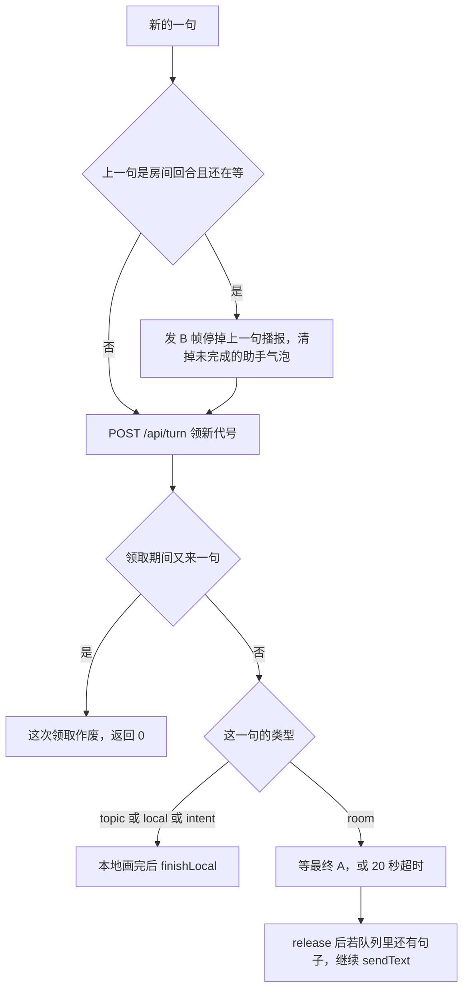

规则：

- 只有上一句正在等房间回复时，新句子才发 `[B]` 打断播报。报修卡、设备选择卡画在本地，结束后再提问，不发打断。
- 领代号的过程中又来一句，旧的 `claimTicket` 作废，只保留最后一句。
- 房间回合 20 秒没有最终回复，等待自行结束，再发送队列里的下一句。
- 设备意图请求发出约 250 毫秒后，`sendText` 就返回。下一句可以打断这一轮。已经画出的选择卡留在页面上。
- 服务端发现代号已经变了，仍会把 `turn.finish()` 跑完，包括可能已经打到 IoT。返回给页面时带 `superseded`，页面不再画这句的卡片和播报。`src/session.mjs` 里写了这个约定。

## 6. 按住说话

实现：`startHold`、`stopHold`、`finishDictation`，以及 `onAgentFrame` 里对 `[Q]` 的 `dictating` 分支。

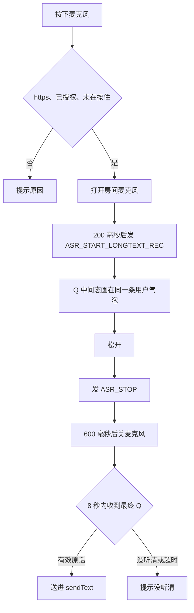

平时麦克风静音。先开麦再开识别，避免房间录到一段静音。先停识别再关麦，避免截掉尾音。按住超过 55 秒会自动松开。

「没有听清」「请再说一遍」不当成用户原话。按住期间的中间结果只更新气泡，松手后的最终 `[Q]` 才进入 `sendText`。非按住状态下，房间自己送来的最终 `[Q]` 也会进入 `sendText`，除非它被认成刚才发出的 `[T]` 回声。

回声比对在 `userEcho()`。从【家庭设备】标记起的内容不算用户说的话。对上已发送原文时只更新气泡，不再追加一条。

## 7. 字幕帧

房间 `onmessage` 进 `onAgentFrame()`。服务端同一套分类在 `src/frames.mjs` 的 `classifyFrame()`。

| 帧 | 页面 | 服务端 |
| --- | --- | --- |
| `[E]:[LIC]:[MUST]` | 回激活帧 | `POST /api/session/lic` 只接受这种帧 |
| `[E]:[LIC]:[RES]:[PASS/FAILED]` | 改授权状态 | `lic-result` 写会话 |
| `[F]` 且已是 `result` | 忽略，这是函数回执不是新调用 | `parseFunction` 返回空，记 ignored |
| `[F]` 且 60 秒内本机刚处理过 `control_device` | 直接回「已由页面列出设备」，不进闸门 | 不经过 `/api/frame` |
| 其他 `[F]` | `POST /api/frame` | `actionFromCall` 后 `turn.finish` |
| `[Q]` | 按住、回声或当新句子 | 帧接口不把用户帧当动作 |
| `[A]:[M]` | 累加到同一条助手气泡 | 中间态不进闸门 |
| `[A]` 最终帧 | `POST /api/frame`，带整句 `finalText` | 摘动作、过闸、过滤正文 |

最终 `[A]` 是整句，不是增量。页面不会把最终帧再接到已累积的片段后面。正文等于「正在处理。」时，终句到达后删掉这条占位。

本机用 `[E]:[CMD]:[TEXT]` 播过的句子记在 `spokenLocal`。房间把它当成 `[A]` 回放时丢掉，避免念两遍。

`extractAction()` 从最终回答里摘动作，顺序是：

1. 优先 ```iot 或 ```json 代码块，且里面有 `action` 字符串。
2. 否则从第一个 `{"action":` 起截出一个完整 JSON 对象。
3. 摘到的块从展示正文里删除。

未知函数名不进闸门。服务端回一帧错误结果：`未接入的意图：名称`。已知的三个名字收成内部动作：

| 函数名 | 内部动作 | 取哪些字段 |
| --- | --- | --- |
| `control_device` | `device.control` | `deviceName`、`cmd`、`param` 默认 `switch`、`value`、`say` |
| `create_scene` | `scene.create` | `conditionList`、`actionList`，字符串会再 `JSON.parse`，加上 `say` |
| `open_repair` | `repair.open` | `kind` 只认 `progress`，其余都当 `report` |

`visibleAgent()` 会丢掉向用户索要 `deviceName`、`cmd`、`请提供` 这类话。`visibleReply()` 会从【家庭设备】标记处截断，并丢掉与用户原话完全相同的复述。

## 8. 数据统计

实现：`src/topic.mjs`，`POST /api/topic`，图片走 `GET /api/topic/image/:id`。

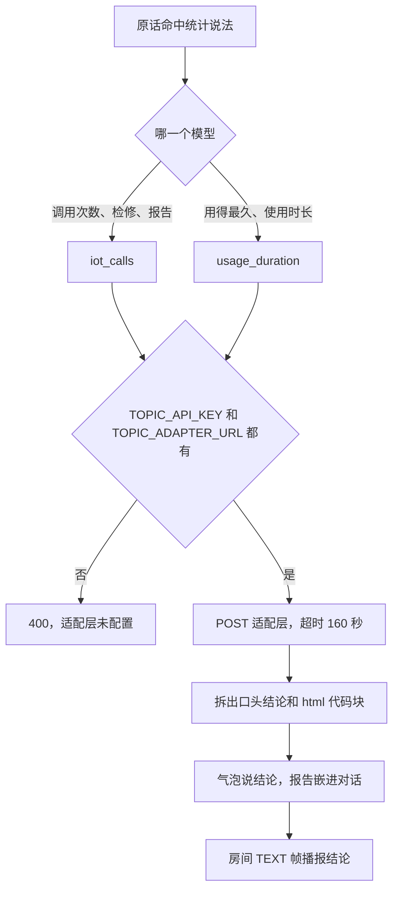

页面正则和 `topicModel()` 是两套相近的词表。页面先决定要不要进这个接口。接口里对不上词表会回 400「不是数据统计话题」。

适配层若把完整 HTML 包在 ```html 代码块里，`topicView()` 取出页面，其余文字当口头结论。只有正文刚好是「图片已生成。」时，`/api/frame` 才去适配层拉最近一张图，再由本服务代理到 `/api/topic/image/:id`。统计分支本身在 `sendText` 里就结束了，不进 `/api/frame`，所以这条生图只挂在房间最终回答上。

## 9. 报修

页面报修和房间函数报修是两条路，跳转地址相同，都不创建工单。

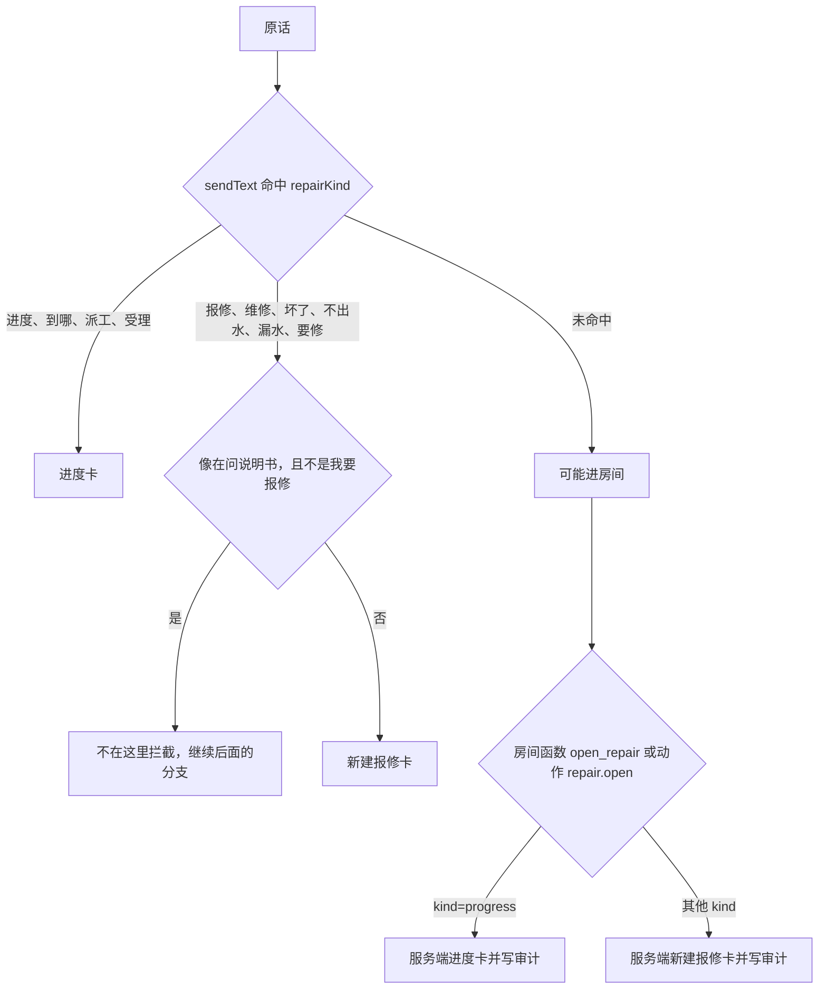

页面 `showRepair()` 不调用 `/api/intent`，也不写 `audit.jsonl`。它领一个 `local` 代号，画卡片，并用 `[E]:[CMD]:[TEXT]` 播「已准备好报修入口。」或「已准备好进度入口。」

「保修几年」「喷枪不出水怎么办」含有「保修」或「不出水」，但因为是问句，`repairKind()` 返回空，句子继续往后走。没有操作词时就进房间，由知识库回答。

房间侧 `turn.finish()` 见到 `repair.open` 就短路：不选设备、不过指令表。按 `kind` 取 `config/scenario.json` 里的文案和 deeplink，审计记 `ALLOW`，等级 `L`。页面收到这种卡片时，若它来自 `[F]` 或最终 `[A]`，`demo.repair` 会被跳过不画。页面自己的报修卡是在 `showRepair()` 里画的。因此用户口头报修走页面卡；只有绕过 `sendText` 分流、直接由模型函数进来的报修，才会在服务端产生卡片，而页面这条路径又把 `demo.repair` 滤掉了。服务端审计仍然会记。

| kind | 跳转 |
| --- | --- |
| report | `arrowhome://repair/create?from=ai_assistant` |
| progress | `arrowhome://repair/list?from=ai_assistant` |

## 10. 设备指令：从原话到动作

本机入口把动作先做成一条空的 `device.control`，再交给和函数调用相同的 `turn.finish()`。

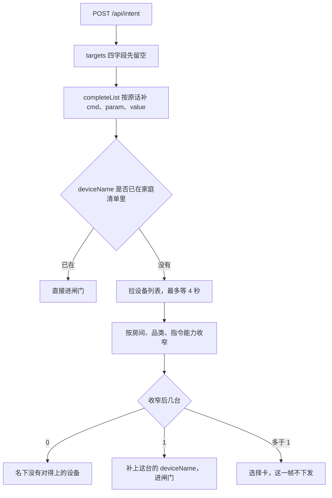

补槽在 `src/resolve.mjs`。模型或空动作没填的字段才补，已经填了的不改。对不上的留给闸门拒绝。

原话到 `cmd` 的顺序是长说法优先：

| 原话里的说法 | cmd |
| --- | --- |
| 小冲、小便冲水、冲小 | `switch_watering_small` |
| 大冲、冲水、冲一下、单独一个冲 | `switch_watering` |
| 自动翻盖、翻盖 | `switch_auto_closing` |
| 脚触感应、脚触 | `switch_kicking` |
| 自动润瓷、润瓷 | `switch_auto_oiling_porcelain` |
| 夜灯 | `switch_night_light` |
| 进水、放水 | `switch_water_in` |

`param` 空着就填 `switch`。`value` 先看关闭、关掉、停用、别，这些是 `off`；再看打开、冲水、夜灯、进水等，这些是 `on`。大冲和小冲的指令表只允许 `on`，用户说关掉大冲时会补出 `off`，闸门以「参数值非法」拒绝。

开关类若原话里没有夜灯、冲水、进水这些词，`commandFromText()` 补不出 `cmd`。闸门会因为缺少 `cmd` 拒绝。页面若没有 `say` 也没有卡片，会显示「这一句没有形成可下发的指令。」

收窄顺序：

1. 原话里的「主卫」或「客卫」。名单里没有房间字段的设备不会因房间被排除。
2. 品类。马桶、大冲、小冲、翻盖、脚触、润瓷到 `01`。浴缸、进水、放到 `04`。镜柜、夜灯到 `06`。原话没有品类时，若这条指令只出现在一个品类上，用那个品类。
3. 设备 `capability` 是否包含这条 `cmd`。
4. 在线状态不参与过滤。离线设备可以下发，平台拒绝后再记失败。

多台时选择卡按钮用「房间 + 设备名」。同名按 1、2 区分。点一台走 `POST /api/choose`：同一个 `choiceId` 只能成功一次，第二次 409。服务端把空的 `deviceName` 填上，再跑一遍 `turn.finish()`。

0 台时卡片是闸门拒绝样式，口头是「名下没有对得上的设备，这一次没有下发。」

本机意图完成后 60 秒内，房间若再推来同一次 `control_device`，页面不调用 `/api/frame`。它回一帧不带 `post_function` 的结果：「已由页面列出设备，请用户点选，不要再追问设备。」

## 11. 安全闸门

实现：`src/policy.mjs` 的 `evaluate()`。模型只表达想做什么，能不能下发只看这里。

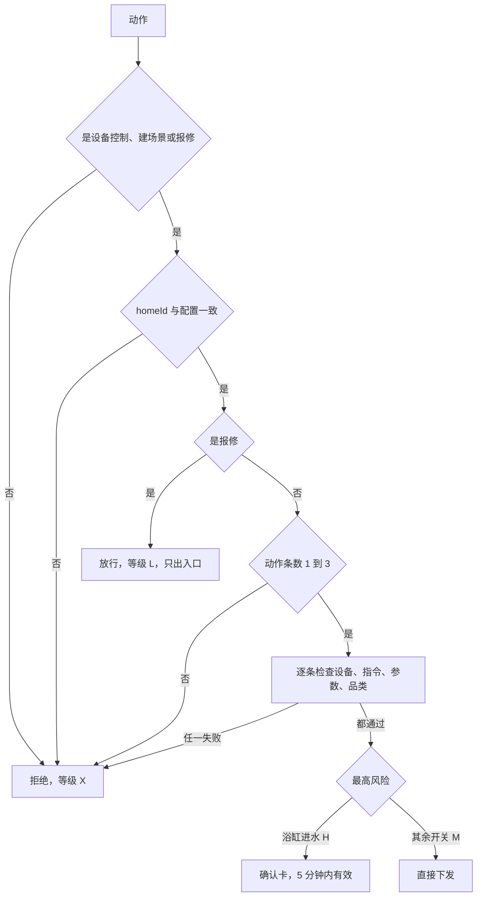

逐条检查的失败原因会写明属于「设备指令」「场景触发条件」或「场景执行动作」：

- 缺少 `deviceName`、`cmd`、`param`、`value` 任一字段。
- 设备不在这份家庭名单。
- `cmd` 不在 `scenario.json` 的八条指令里。
- 该品类不支持这条指令。
- 参数名不是 `switch`，或取值不在该指令允许的 `on` / `off` 里。

风险只按配置：

| 命中 | 等级 | 结果 |
| --- | --- | --- |
| `cmd` 为 `switch_water_in` | H | `confirm`。写一张待确认单，页面点「确认执行」才下发 |
| `param` 为 `switch` | M | 未到高危，直接 `allow` |
| 都没命中 | M | 用默认等级，同样直接下发 |
| 到达 C | 拒绝 | 当前没有规则会产出 C。`denyAtOrAbove` 留着 |

待确认单的状态：`PENDING` 经 `claim()` 变成 `EXECUTING`，执行完写成 `SUCCEEDED` 或 `FAILED`。用户取消写成 `REJECTED`。超过 5 分钟在下次 `claim()` 时写成 `EXPIRED`，没有后台定时器。重复确认会得到「动作已是 EXECUTING」，所以双击只会下发一次。

`POST /api/confirm` 的 `decision` 为 `cancel` 时只拒绝并写审计，不打 IoT。其他值走 `claim` 后执行。页面只发送 `confirm` 或 `cancel`。

## 12. 下发与回执

`decision=allow` 时 `turn.execute()` 立刻打 IoT。高危要等确认接口。

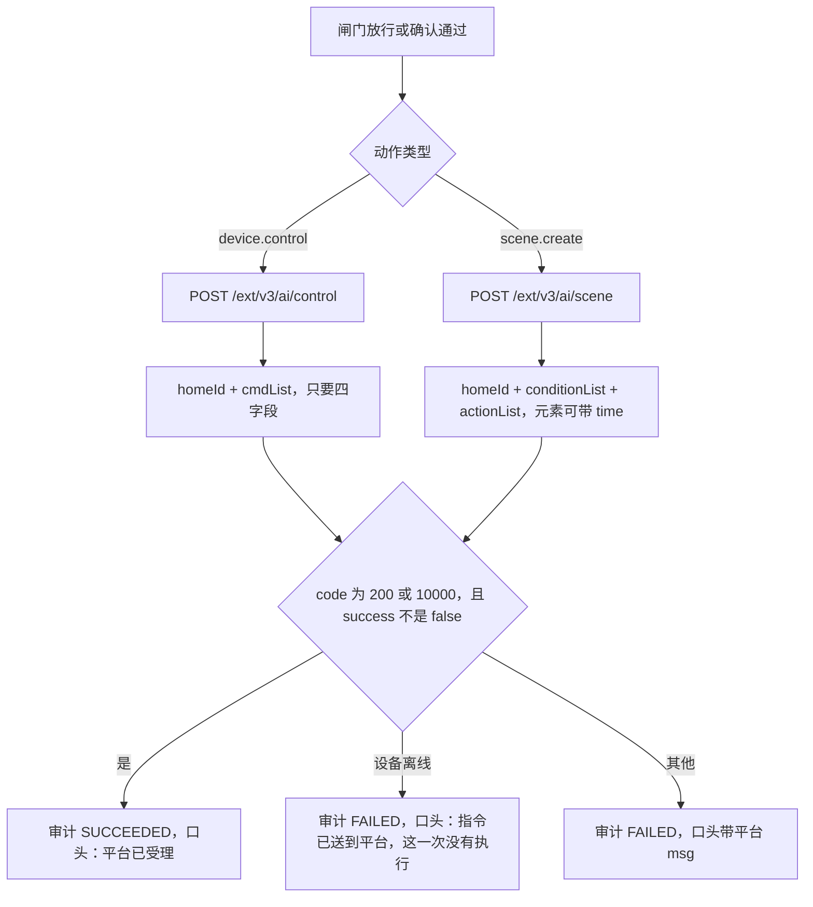

受理条件在 `execute()`：HTTP 调用本身 `ok`，body 是对象，`success !== false`，且 `code` 为空、200 或 10000。平台常用 HTTP 200 加 `code: 500` 表示设备离线，这记失败。

函数调用进来时，服务端再回一帧 `[F]`：

- 受理、或只是给出确认卡、或是报修：`result=ok`。
- 确认卡的播报固定为「这一步需要你在页面上确认后才会发给平台。」
- 其他情况播报 `receipt`。没有可说的话就不带 `post_function`，避免模型自由发挥。

执行卡 `demo.result` 画在对话里。审计页只读 `audit.jsonl` 最近 80 条，展示时间、类型、等级和判定，不展示 token。

`src/audit.mjs` 的 `redact()` 把 `authorization`、`token`、`api_key`、`ak`、`sk`、`lickey` 换成 `***`，并把字符串里的 `bearer ...` 抹掉。卡片流水和返回给页面的执行结果都走这份脱敏。

## 13. 建场景

链路在 `create_scene` 函数或回答里的 `scene.create`。`conditionList` 和 `actionList` 都要是设备指令数组。`time` 是挂在一条完整指令上的可选字段，四个必填字段仍然要在。只有 `{"time":"07:00"}` 会在闸门被拒绝。

两条列表都走 `completeList()`。选设备时只看 `actionList` 里有没有不可信的 `deviceName`。条件列表里的设备号不会单独触发选择卡。一次动作加起来不能超过 3 条，条件和动作都逐条过指令表。

IoT 体是 `{ homeId, conditionList, actionList }`，地址 `POST /ext/v3/ai/scene`。开场示例没有定时场景。用户口头说「每天打开夜灯」时，第 3 节的本地分支会先把它当成设备控制，句子到不了房间，这条建场景函数不会被调用。

## 14. 设备列表

`GET /api/devices?fresh=1` 给设备页。处理指令时 `liveDevices()` 默认用 20 秒缓存，选设备时传入 `force` 的路径在 `chooseDevice()` 里是 `load(false)`，所以沿用缓存。

列表来自 `GET /ext/v3/ai/device-list?homeId=933`。页面按房间分组，没有房间名的归到「未分配房间」。接口失败且缓存也空时显示错误。平台一台都没有时显示「家里还没有设备。」

`deviceRows()` 会把名单里有、但这次接口没返回的设备补进列表，在线状态记为离线。房间名来自本地名单，不来自平台返回。

IoT 客户端在 `src/iot-client.mjs`。请求头是 `Authorization: bearer <token>`、`appPlatform: arrow`、`ArrowDeviceSystemPlatform: 0`。401 或 403 记成 token 无效或过期。网关连不上时 `ok=false`，错误是「网关不可达」。

## 15. 产品问答

没有命中统计、报修、设备操作的句子，`sayToRoom()` 发送 `[T]:原话`。房间用控制台人设和知识库意图模板作答。本服务不检索说明书。

最终 `[A]` 到达后：

1. 若是本机刚播过的句子，丢掉。
2. 代号过期则整段丢掉。
3. `POST /api/frame`。没有 `iot` 动作时 `turn.finish()` 直接返回空卡片。
4. 展示文本去掉代码块、设备清单和向用户索要字段名的句子。
5. 若过滤后的正文刚好是「图片已生成。」，再代拉一张统计图。
6. 画助手气泡，有卡片就追加，然后 `releaseRoom`。

知识库答错路由、串库或先说「准备查看」，要改的是控制台模板和人设，不是这条 H5 分支。

## 16. 三个页面

`index.html` 有通话、设备、审计。窄屏时导航在上方，逻辑与桌面相同。

| 视图 | 打开时做什么 | 数据 |
| --- | --- | --- |
| 通话 | 进页自动 `startCall` | 对话、卡片、开场 5 条示例 |
| 设备 | `GET /api/devices?fresh=1` | 房间、名称、设备号、在线 |
| 审计 | `GET /api/audit` | 最近 80 条操作 |

开场示例写在 `config/scenario.json` 的 `starters`，由 `GET /api/config` 带给页面。点一条等于调用 `sendText`，所以「把主卫的浴缸进水打开」走设备分支并出确认卡，「我家坐便器不出水了，要报修」走报修卡，「AKB1357 有哪些功能」走房间。

`GET /api/cards?sessionId=` 能读 `cards.jsonl`，当前页面没有用它做历史回放。流水在每次 `turn.finish` 产出卡片时追加，确认结果另记一条 `appendResolve`。

## 17. 模块与文件

| 模块 | 文件 | 做什么 |
| --- | --- | --- |
| HTTP 与分流入口 | `server.mjs` | 路由、设备缓存、帧与意图的收口 |
| 建实例与授权帧 | `src/aiagent.mjs` | BCE 签名、ACTIVE 帧、停实例 |
| 通话记录 | `src/session.mjs` | 会话、代号、授权状态 |
| 帧分类 | `src/frames.mjs` | `[F]`、`[A]`、`[Q]`，函数收成动作 |
| 补槽与选设备 | `src/resolve.mjs` | 原话到指令，多台收窄 |
| 闸门 | `src/policy.mjs` | 合法性、风险、待确认单 |
| 执行 | `src/turn.mjs` | 报修短路、下发、确认、回执文案 |
| IoT | `src/iot-client.mjs` | 三个平台接口 |
| 设备清单文本 | `src/roster.mjs` | 【家庭设备】段落，以及气泡截断 |
| 统计话题 | `src/topic.mjs` | 模型名、报告 HTML、生图口头句 |
| 审计 | `src/audit.mjs` | `audit.jsonl`，脱敏 |
| 卡片流水 | `src/journal.mjs` | `cards.jsonl` |
| 配置 | `scenario.mjs`、`config/scenario.json` | 指令表、风险、报修文案、开场白 |
| 页面 | `public/app.js`、`public/turn-gate.js` | 分流、语音、字幕、三块视图 |

## 18. 和文档旧描述不同的地方

这些是读当前代码得到的，避免按旧 README 去对线上行为。

- 设备清单没有附在 `[T]` 后面。`/api/roster` 还在，页面发送路径没调用它。
- 「每天、自动、定时」会走本地设备控制，不会把句子送进房间去调用 `create_scene`。
- 口头报修在页面画卡，不写审计。函数报修在服务端写审计，但页面从帧结果里跳过 `demo.repair` 卡片。
- 代号过期之后，IoT 可能已经发出。页面只是不再展示。
- 在线状态不参与选哪一台，也不在闸门里拦截。

## 关联

控制台人设、函数参数和知识库意图在 `产品文档/后台控制台交付配置.md`。IoT 字段在 `docs/箭牌IoT接口.md`。模块图在 `docs/模块架构.html`。

- [[DumateApi接入-索引]]
- [[后台控制台交付配置]]
- [[箭牌IoT接口]]
- [[配置参数清单]]
