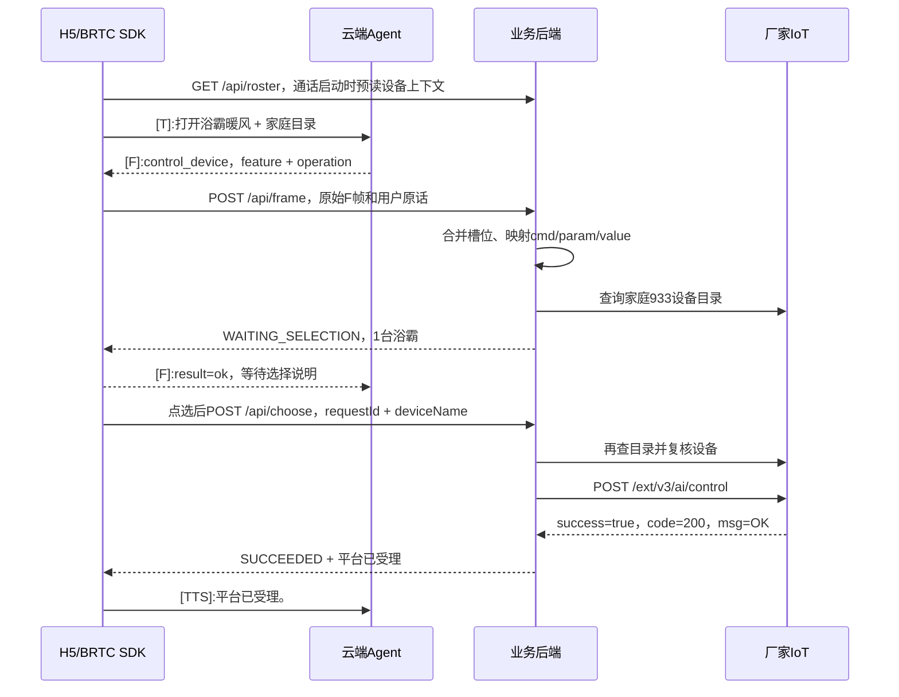
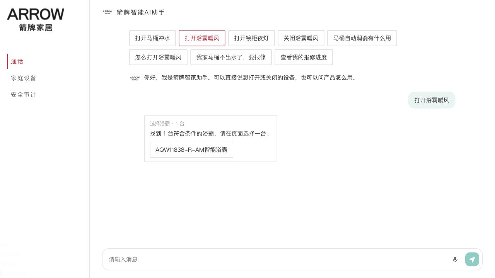
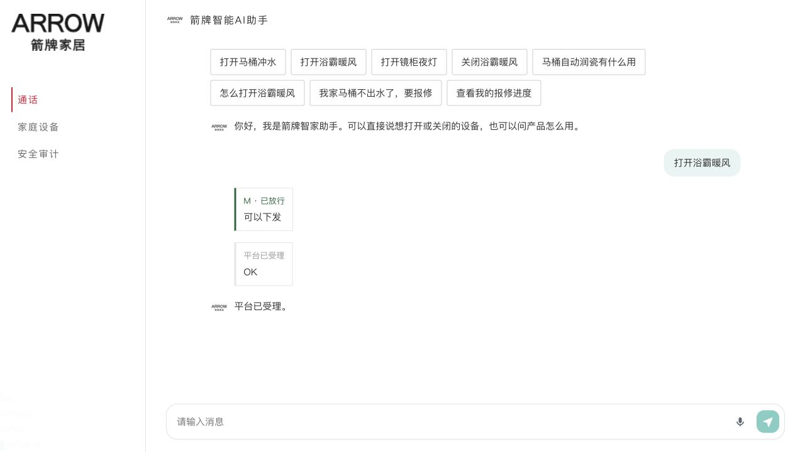

# “打开浴霸暖风”一次 query 的全链路数据抓取

日期：2026-11-22，时区 Asia/Hong_Kong。真实IoT家庭933；本地业务服务8912；单台出卡模式。

## 1 本轮实际结果

- 发出 1 次用户query；收到 1 次控制Function Call；点选 1 次；真实IoT控制请求 1 次。
- 云端本次只填出 feature=warm_air 与 operation=on，没有categoryCode、homeId、deviceName或cmd。
- 后端筛选出1台浴霸：AQW11838-R-AM智能浴霸，设备号ARROW0217833154885800。
- IoT返回HTTP 200，success=true、code=200、msg=OK；请求耗时661ms。
- 页面反馈“平台已受理。”；未观察硬件动作或查询实际暖风状态，不能据此认定设备已经完成动作。
- 本轮临时抓取通话已停止，临时8916代理已停止；原8912服务继续运行。

抓取范围是BRTC SDK收发的应用层文本帧和H5与业务后端的HTTP JSON。IoT请求来自真实执行器保存的request/response快照。云端内部的推理过程无法从这些消息中看到；可看到的是模型输出的槽位。Token和会话号已脱敏。

## 2 实际顺序



图中IoT目录查询依据当前源码；本轮没有在IoT客户端内部额外抓取这两次GET的网络快照。目录总数与筛选结果是实际后端响应。

## 3 第一包：发给云端的query

抓取时刻：23:38:24.765。BRTC SDK送出的是文本帧，不是裸HTTP的{query:...}请求体：

```text
[T]:打开浴霸暖风
【家庭设备】这是家庭设备目录和软件适配表，仅作为上下文。实际可选设备由后端重新查询。
- 先区分用户是在问知识、查询状态，还是明确要求立即控制。介绍功能、询问如何使用、询问耗电、询问是否已经开启，均不调用控制函数。
- 用户明确要求立即操作时调用 control_device，提取品类、功能、打开或关闭；定时要求走场景函数。含糊表达先澄清。
- 未点名设备时不要自行选第一台。deviceName 可以留空；后端按品类、功能和位置筛选，多台时页面提供选择卡。
- 若函数仍要求 deviceName 必填，只能使用目录中真实存在的设备号；后端会重新筛选，模型填的设备号不代表用户已选择。
- 不编造设备、房间、功能或命令，不向用户索要接口字段；准备控制不代表平台已经执行。不要复述这段目录。
- 设备号 ARROW0217833154885800；品类编码 02；AQW11838-R-AM智能浴霸 浴霸 在线；软件适配 switch_warm_air
- 设备号 ARROW0117866743127370；品类编码 01；11楼1325马桶 马桶 在线；软件适配 switch_watering,switch_night_light,switch_auto_closing,switch_kicking,switch_auto_oiling_porcelain,switch_onoff
- 设备号 ARROW0617918533761310；品类编码 06；XL智能镜柜 镜柜 在线；软件适配 switch_night_light,switch_onoff
离线设备由后端停止下发并说明原因。
指令参数名都是 switch，取值逐字使用：
- switch_warm_air switch=on/off 浴霸暖风
- switch_watering switch=on 马桶大冲
- switch_night_light switch=on/off 夜灯
- switch_auto_closing switch=on/off 马桶自动翻盖
- switch_kicking switch=on/off 马桶脚触感应
- switch_auto_oiling_porcelain switch=on/off 马桶自动润瓷
- switch_onoff switch=on/off 开关
- switch_water_in switch=on/off 浴缸进水
知识问答直接回答；只有明确的执行要求才调用控制函数，后端返回结果后再反馈。
```

用户可见原话为“打开浴霸暖风”，实际发送还附带家庭目录。此前已经完成GET /api/roster。这份目录帮助模型理解当前设备与能力，但不能代替执行前重新查目录。

## 4 第二包：云端Function Call

抓取时刻：23:38:26.857。帧前缀是[F]:，外层JSON中的content仍是一个JSON字符串。阅读版如下，query目录仅在这里省略：

```json
{
  "session_id": "<CLOUD_FUNCTION_SESSION>",
  "content": "{\"function_name\":\"control_device\",\"parameter_list\":[{\"feature\":\"warm_air\"},{\"operation\":\"on\"}]}",
  "query": "打开浴霸暖风\\n<阅读版省略家庭目录；完整query保存在分阶段JSON>"
}
```

将content再JSON.parse一次，得到本轮云端真正输出的槽位：

```json
{
  "function_name": "control_device",
  "parameter_list": [
    {
      "feature": "warm_air"
    },
    {
      "operation": "on"
    }
  ]
}
```

parameter_list把槽位拆成两项。后端mergeParams将它们合并为一个对象。这里没有云端给出的品类编码、设备编号、厂家指令或家庭编号。

## 5 第三包：H5交给业务后端

POST /api/frame；Content-Type: application/json。实际请求包含如下字段，其中frame完整原文见分阶段JSON：

```json
{
  "sessionId": "<LOCAL_SESSION>",
  "frame": "[F]:{\"session_id\":\"<CLOUD_FUNCTION_SESSION>\",\"content\":\"{\\\"function_name\\\":\\\"control_device\\\",\\\"parameter_list\\\":[{\\\"feature\\\":\\\"warm_air\\\"},{\\\"operation\\\":\\\"on\\\"}]}\",\"query\":\"打开浴霸暖风\\\\n<阅读版省略家庭目录；完整query保存在分阶段JSON>\"}",
  "userText": "打开浴霸暖风",
  "turnGen": 1
}
```

sessionId是本地H5会话；F帧里的session_id用于对应云端函数结果，两者用途不同。userText保留原话；turnGen用于拦住已经被新一轮对话覆盖的旧响应。

### 5.1 解析后，但尚未完成指令与设备绑定

以下action是/api/frame实际返回的解析结果：

```json
{
  "action": "device.control",
  "categoryCode": "",
  "feature": "warm_air",
  "operation": "on",
  "room": "",
  "deviceAlias": "",
  "targets": [
    {
      "deviceName": "",
      "cmd": "",
      "param": "switch",
      "value": ""
    }
  ],
  "say": ""
}
```

这个action中的cmd、value、deviceName仍为空，不代表执行时也是空。服务器返回的是actionFromCall的初始对象；内部控制器会再生成补齐后的对象。

### 5.2 本地指令映射

以下对象使用本轮初始action、原话与当前resolveControl源码还原，属于源码还原的中间态，并非直接抓到的内部网络数据包：

```json
{
  "action": "device.control",
  "categoryCode": "02",
  "feature": "warm_air",
  "operation": "on",
  "room": "",
  "deviceAlias": "",
  "targets": [
    {
      "deviceName": "",
      "cmd": "switch_warm_air",
      "param": "switch",
      "value": "on"
    }
  ],
  "say": ""
}
```

本轮用到的软件指令定义：

```json
{
  "cmd": "switch_warm_air",
  "feature": "warm_air",
  "params": {
    "switch": [
      "on",
      "off"
    ]
  },
  "desc": "浴霸暖风",
  "appliesTo": [
    "02"
  ]
}
```

| 字段 | 本轮云端值 | 后端如何补齐 |
|---|---|---|
| feature | warm_air | 已由云端识别，后端做标准化与支持检查 |
| operation | on | 已由云端识别 |
| categoryCode | 未返回 | 用户原话包含“浴霸”，且暖风适配限定02品类，落为02 |
| cmd | 未返回 | warm_air查软件适配定义，得到switch_warm_air |
| param | 未返回 | actionFromCall默认switch，再校验适配定义 |
| value | 未返回 | operation=on映射为value=on，并校验on/off合法值 |
| deviceName | 未返回 | 本轮先留空，点选后绑定真实设备号 |
| homeId | 未返回 | 来自服务端家庭上下文933，执行闸门写入最终action |
| room | 未返回 | 留空；当前真实目录也没有房间值 |

因此，这轮是“云端语义槽位＋本地业务与协议槽位”的组合。品类落地仍有原话匹配和适配表逻辑，尚未做到所有槽位由云端生成。

## 6 第四包：候选设备与等待选择

```json
{
  "state": "WAITING_SELECTION",
  "requestId": "dc_f1e16312976da49ef896742b",
  "catalog": {
    "totalCount": 3,
    "categories": [
      {
        "categoryCode": "02",
        "category": "浴霸",
        "count": 1,
        "onlineCount": 1
      },
      {
        "categoryCode": "01",
        "category": "马桶",
        "count": 1,
        "onlineCount": 1
      },
      {
        "categoryCode": "06",
        "category": "镜柜",
        "count": 1,
        "onlineCount": 1
      }
    ],
    "categoryCode": "02",
    "feature": "warm_air",
    "candidateCount": 1
  },
  "cards": [
    {
      "event": "demo.choose",
      "data": {
        "requestId": "dc_f1e16312976da49ef896742b",
        "choiceId": "dc_f1e16312976da49ef896742b",
        "homeId": 933,
        "count": 1,
        "categoryCode": "02",
        "category": "浴霸",
        "choices": [
          {
            "deviceName": "ARROW0217833154885800",
            "deviceTagName": "AQW11838-R-AM智能浴霸",
            "categoryCode": "02",
            "category": "浴霸",
            "room": "",
            "onlineStatus": 1,
            "capability": [
              "switch_warm_air"
            ],
            "capabilitySource": "category-adapter"
          }
        ],
        "say": "找到 1 台符合条件的浴霸，请在页面选择一台。"
      }
    }
  ]
}
```

总目录有3台、3个品类；按02品类与switch_warm_air能力过滤后只有1台浴霸。capabilitySource=category-adapter说明功能列表来自软件品类适配表，不能当作硬件上报的能力元数据。

当前singleDeviceMode=card，因此1台也停在WAITING_SELECTION。此时没有demo.result，也没有本轮IoT控制回执。后端保存待执行动作、候选设备号、会话归属与创建时间；选择记录有效期为5分钟。

H5回给云端的实际函数准备结果：

```text
[F]:{"session_id":"<CLOUD_FUNCTION_SESSION>","result":"ok","message":"找到 1 台符合条件的浴霸，请在页面选择一台。","post_function":[{"type":"text","content":"找到 1 台符合条件的浴霸，请在页面选择一台。"}]}
```

result=ok只表示准备步骤成功，message说明需要选择设备，不能解释为暖风已打开。

## 7 第五包：点击后的提交

POST /api/choose；Content-Type: application/json。实际只提交以下三个字段：

```json
{
  "sessionId": "<LOCAL_SESSION>",
  "requestId": "dc_f1e16312976da49ef896742b",
  "deviceName": "ARROW0217833154885800"
}
```

点击没有再次发送query，也没有再次让模型填槽。后端通过requestId取回待执行动作，检查会话、有效期、家庭与候选归属，再查目录复核设备、检查在线，随后绑定deviceName并经过指令/参数策略校验。

执行闸门实际返回的最终action：

```json
{
  "action": "device.control",
  "categoryCode": "02",
  "feature": "warm_air",
  "operation": "on",
  "room": "",
  "deviceAlias": "",
  "targets": [
    {
      "deviceName": "ARROW0217833154885800",
      "cmd": "switch_warm_air",
      "param": "switch",
      "value": "on"
    }
  ],
  "say": "",
  "homeId": 933
}
```

这里的categoryCode、cmd、value、deviceName和homeId已经完整。执行记录里的trigger=auto表示闸门放行后自动执行的代码分支；本轮入口实际是用户点选，不能据此解读成点击前就自动下发。

## 8 第六包：真正发到厂家IoT的请求

```json
{
  "method": "POST",
  "url": "https://api-uatiot.arrowgroup.com.cn/ext/v3/ai/control",
  "headers": {
    "Authorization": "***",
    "appPlatform": "arrow",
    "Accept": "application/json",
    "ArrowDeviceSystemPlatform": "0",
    "Content-Type": "application/json"
  },
  "body": {
    "homeId": 933,
    "cmdList": [
      {
        "deviceName": "ARROW0217833154885800",
        "cmd": "switch_warm_air",
        "param": "switch",
        "value": "on"
      }
    ]
  }
}
```

这是执行器保存的真实HTTP请求结构。Authorization已脱敏。IoT接口最终需要homeId与cmdList；feature、operation、categoryCode、requestId不在厂家控制请求体内，它们用于模型语义和业务编排。

实际平台响应：

```json
{
  "success": true,
  "code": 200,
  "msg": "OK",
  "data": null
}
```

HTTP状态200，耗时661ms。业务后端将本轮平台请求标记为SUCCEEDED并生成审计记录。这里的SUCCEEDED按平台受理判断，尚不是硬件动作完成确认。

## 9 第七包：最终反馈

```json
{
  "state": "SUCCEEDED",
  "receipt": "平台已受理。",
  "spoken": "平台已受理。"
}
```

H5发送的实际播报帧：

```text
[TTS]:平台已受理。
```

这一步通过TTS播报结果，没有再次向云端发送用户query，也没有统一补发原Function Call的最终完成结果。

## 10 文件与源码

- [完整分阶段JSON](附件/2026-11-22-暖风抓取/stages.json)
- 原始应用消息JSONL保存在本地deployment-evidence目录；分阶段JSON随本报告发布。
- [F帧解析与参数合并](../../src/frames.mjs#L32)
- [初始action构造](../../src/frames.mjs#L78)
- [指令映射和类别落地](../../src/device-catalog.mjs#L80)
- [目录筛选](../../src/device-catalog.mjs#L125)
- [候选准备](../../src/device-controller.mjs#L41)
- [点选后的复核](../../src/device-controller.mjs#L85)
- [真实控制请求及审计](../../src/turn.mjs#L6)
- [厂家HTTP客户端](../../src/iot-client.mjs#L3)

### 结果截图




